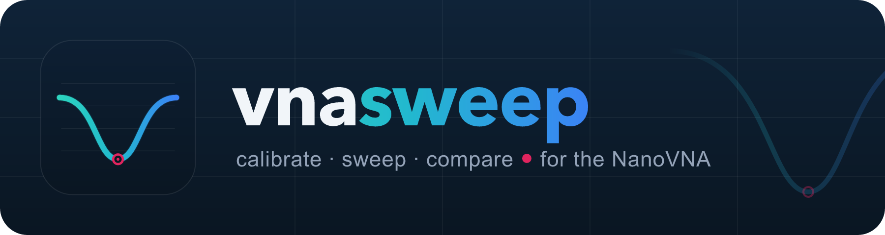
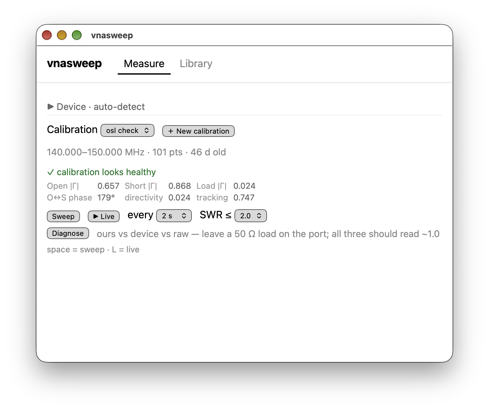

<p align="center">
  
</p>

<p align="center">
  <a href="https://github.com/zpeters/vnasweep/actions/workflows/ci.yml"></a>
  <a href="LICENSE"></a>
  
  
</p>

A small desktop app for the usual job with a
[NanoVNA](https://nanovna.com/): calibrate, sweep an antenna's SWR, and
compare the trace with the last one. The stock PC software and
NanoVNA-Saver can do much more. vnasweep does only this, quickly.

Each reading is a Touchstone `.s1p` file plus a small JSON file, in a
folder in your home directory. You can open them in other tools, diff
them, and keep them in git. There is no account and no telemetry.

<p align="center">
  
</p>

## Features

- **Calibrate.** A 3-step Open / Short / Load wizard makes a one-port
  OSL calibration in the app and saves it as a file. A health check
  finds a swapped or disconnected standard.
- **Sweep.** One sweep, or live sweeps that repeat, over a calibrated
  span. A marker shows the minimum SWR with R ± jX and return loss at
  the dip. Amateur bands are shaded, and the app shows the bandwidth
  where SWR ≤ 1.5, 2 or 3.
- **Save and compare.** Give a reading a name. Show several readings on
  one plot, or the difference between two. Export as `.s1p` or `.csv`.
- **Diagnose.** One pass plots the app's OSL correction, the device's
  own correction (`cal on`) and the raw data together, so you can see
  where a bad reading comes from.
- **Keyboard.** Space sweeps once; L starts or stops live sweeps.

Tested with a NanoVNA-H (firmware 1.2.27, USB `0483:5740`) on macOS.
CI builds and tests on macOS and Linux.

## Install

### macOS

Download the `.dmg` from the
[latest release](https://github.com/zpeters/vnasweep/releases/latest), open
it, and drag **vnasweep** into **Applications**. The build is for Apple
Silicon.

The app is not notarised yet, so macOS blocks it the first time. To open
it, try once, then go to **System Settings → Privacy & Security** and
click **Open Anyway**. Or run:

```sh
xattr -dr com.apple.quarantine /Applications/vnasweep.app
```

### Linux

Download the `.deb` or the `.AppImage` from the
[latest release](https://github.com/zpeters/vnasweep/releases/latest).
To use the NanoVNA without root, add yourself to the `dialout` group
(`uucp` on Arch), then log out and in again.

### From source

You need Rust (from [rustup](https://rustup.rs/)). The Nix flake and
direnv supply `just`, Node.js and `resvg`. On Linux you also need the
[Tauri system packages](https://tauri.app/start/prerequisites/#linux) and
`libudev-dev`.

```sh
git clone https://github.com/zpeters/vnasweep
cd vnasweep
just tauri-dev    # open the app with hot reload
just install      # build vnasweep.app and copy it into /Applications (macOS)
```

## Where your data is

```
~/vnasweep/
  cals/<name>.json          a calibration: span, points and the raw O/S/L captures
  readings/<name>.s1p       a reading, as Touchstone S11 (RI format)
  readings/<name>.json      its name, date and calibration
```

Set `VNASWEEP_HOME` to use a different folder.

## Development

```sh
just          # list the recipes
just check    # cargo fmt --check, clippy (warnings are errors), cargo test,
              # svelte-check and vitest
just dmg      # build the .dmg into target/release/bundle/dmg/
just logo     # render the banner and social preview PNGs from their SVGs
```

The recipes that need JavaScript packages run `npm ci` when
`node_modules` is missing or older than `package-lock.json`.

- `src-tauri/src/` is the Rust backend: a pure core (protocol parsing,
  OSL and SWR math) and a thin shell (serial port, files, Tauri
  commands). `src/` is the Svelte frontend.
  [`AGENTS.md`](AGENTS.md) describes the modules and the project rules.
- `docs/superpowers/` holds the design specs and plans: *why* things are
  the way they are.
- Ideas and planned work are in
  [GitHub Issues](https://github.com/zpeters/vnasweep/issues).

### Releases

Set the same version in `src-tauri/tauri.conf.json`,
`src-tauri/Cargo.toml` and `package.json`, then push a tag such as
`v0.2.0`. The release workflow builds the macOS `.dmg` and the Linux
`.deb` and `.AppImage`, and attaches them to a draft release. Edit the
notes and publish it.

## License

vnasweep is free software under the
[GNU General Public License v3.0 or later](LICENSE).
